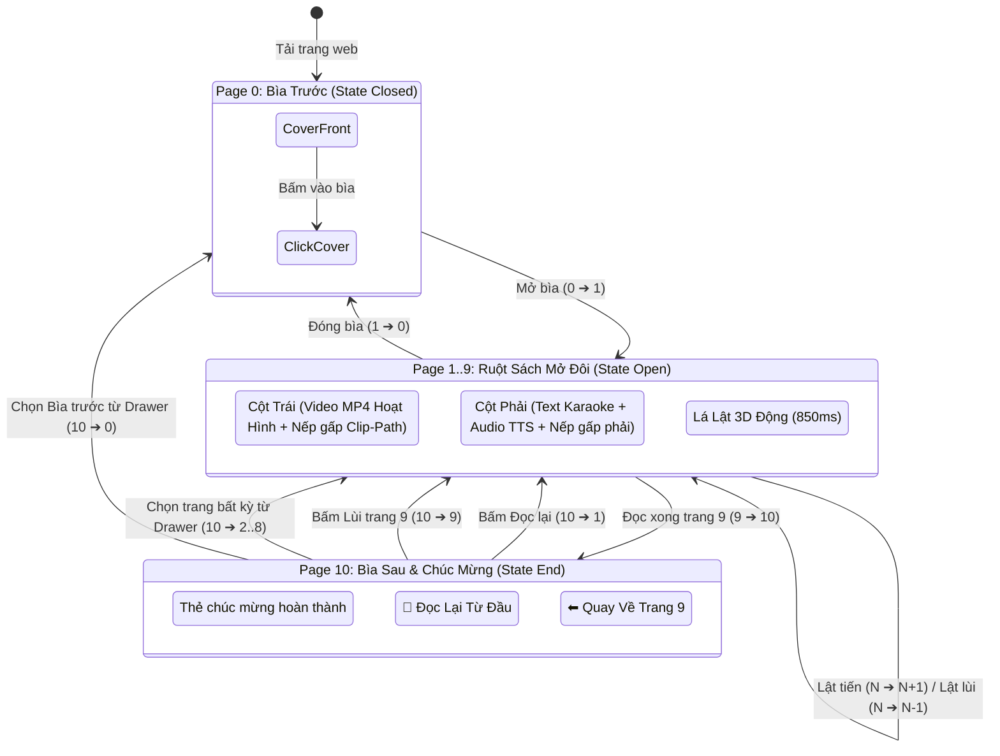

# 📘 TÀI LIỆU TOÀN DIỆN DỰ ÁN (PROJECT SPECIFICATION & HANDOFF MANUAL)
## Dự án: Sách Lật Điện Tử Tương Tác 3D - "Mai và Chuyến Phiêu Lưu Của Những Biển Báo"

> **Dành cho Lập trình viên & Trợ lý AI mới:**  
> Tài liệu này lưu trữ **100% ngữ cảnh, lịch sử yêu cầu của tác giả, kiến trúc kỹ thuật, mã nguồn, thuật toán, và các quy tắc bất di bất dịch** của dự án.  
> Khi bắt đầu phiên làm việc mới (hoặc chuyển sang mô hình AI khác), AI chỉ cần đọc file này là có thể nắm bắt toàn bộ trạng thái hiện tại mà không làm mất context hay tốn token thừa.

---

## 📌 PHẦN 1: THÔNG TIN TỔNG QUAN & TÁC QUYỀN

- **Tên tác phẩm:** Mai và Chuyến Phiêu Lưu Của Những Biển Báo
- **Tác giả:** **Lê Huỳnh Kim Thanh** *(LƯU Ý ĐẶC BIỆT: Luôn viết đúng thứ tự họ tên là "Lê Huỳnh Kim Thanh", TUYỆT ĐỐI KHÔNG đảo thành "Kim Thanh Lê Huỳnh")*
- **Đối tượng độc giả:** Thiếu nhi từ 3 – 8 tuổi, phụ huynh, giáo viên mầm non và tiểu học.
- **Nội dung giáo dục:** Câu chuyện bé Mai đi dạo phố cùng mẹ, học cách nhận biết các biển báo giao thông quan trọng (Biển nguy hiểm trẻ em, Biển cấm quẹo trái, Biển ưu tiên ô tô, Biển tốc độ tối đa 40 km/h, ngã tư đèn tín hiệu, vạch qua đường, đội mũ bảo hiểm).
- **Môi trường vận hành:** 
  - Web tĩnh 100% (HTML5 / CSS3 / JavaScript thuần), chạy mượt mà ngay cả khi Offline (chỉ cần bấm mở file `index.html`).
  - Đã xuất bản và host trực tuyến qua **GitHub Pages**: [https://vocongminhhb55.github.io/sach-lat-mai-va-bien-bao/](https://vocongminhhb55.github.io/sach-lat-mai-va-bien-bao/)
  - Git Repository: `vocongminhhb55/sach-lat-mai-va-bien-bao` (Nhánh: `main`).

---

## 📜 PHẦN 2: LỊCH SỬ TẤT CẢ YÊU CẦU & CHỈ ĐẠO CỦA NGƯỜI DÙNG (CHRONOLOGICAL REQUIREMENTS)

Tất cả các quyết định thiết kế và thay đổi trong mã nguồn đều xuất phát từ các yêu cầu cụ thể của người dùng qua các giai đoạn:

| STT | Nội dung yêu cầu từ User | Phân tích & Giải pháp kỹ thuật đã triển khai | Trạng thái |
|:---:|:---|:---|:---:|
| **1** | Tư vấn cách host nếu chọn phương án Web tĩnh. | Chọn giải pháp GitHub Pages: Miễn phí, tốc độ cao, tương thích toàn cầu, cập nhật tức thì qua Git. | ✅ Đã hoàn thành |
| **2** | Đã có Web rồi thì có cần Book Creator nữa không? Có GitHub Desktop trong máy, hãy hỗ trợ push lên luôn. | Bỏ Book Creator vì bị giới hạn tính năng; xây dựng Web tương tác độc lập và hướng dẫn/tự động hóa push Git lên GitHub. | ✅ Đã hoàn thành |
| **3** | Đồng ý triển khai toàn diện dự án. | Xây dựng bộ khung giao diện sách lật HTML/CSS/JS kết hợp dữ liệu tranh truyện từ bản PDF gốc. | ✅ Đã hoàn thành |
| **4** | Sách bị nhiều lỗi: Viết unit tests kiểm tra thật kỹ trước khi publish; Giọng đọc đang đọc tiếng Anh, tranh chỉ là khung lắc qua lắc lại; Máy có GPU nên làm local thoải mái; Lật trang đầu bị lỗi nhảy cóc; Chữ highlight xong không unhighlight; Phải kiểm tra kỹ cả video lẫn voice. | - Thay thế voice bằng **VieNeu-TTS** (voice nữ miền Nam `Kim Thanh`) tiếng Việt tự nhiên.<br>- Dùng **Faster-Whisper** trên GPU CUDA trích xuất chính xác timestamp từng từ.<br>- Viết lại Karaoke Engine: Phân loại trạng thái 3 thì: Quá khứ (`karaoke-past` - unhighlight), Hiện tại (`karaoke-current` - phát sáng), Tương lai (chữ thường).<br>- Tạo kịch bản kiểm thử tự động `step4_run_tests.py`. | ✅ Đã hoàn thành |
| **5** | Bỏ chữ "sách lật 3D" và nút bấm mở sách; Hiện tại lật sách bỏ qua trang 1 nhảy đến trang 2; Bỏ tính năng chạm vào hình trong tranh; Muốn tranh biến thành video động như Gemini sinh ra. | - Gỡ bỏ tiêu đề 3D và nút bấm thừa; click trực tiếp vào bìa là lật mở.<br>- Sửa luồng mở sách: Bìa trước (Trang 0) ➔ mở thẳng vào Trang 1.<br>- Bỏ toàn bộ hitbox clickable trên tranh vẽ.<br>- Chuyển hướng sang dựng pipeline sinh video hoạt hình MP4. | ✅ Đã hoàn thành |
| **6** | *"Tôi vẫn muốn hiệu ứng lật, cái quan trọng là hiệu ứng lật mà???"* | **Giữ lại và tối ưu hóa hiệu ứng Lật Sách 3D chân thực (3D Leaf Flip)** bằng pure CSS 3D Transforms (`rotateY`, `transform-origin`, bóng đổ động, uốn cong giấy và âm thanh sột soạt lật sách tự nhiên). | ✅ Đã hoàn thành |
| **7** | Bỏ hoàn toàn chữ "sách lật 3D" và nút mở sách trên trang bìa. | Dọn sạch giao diện trang bìa: Bìa sách hiển thị tranh minh họa thuần túy, sạch sẽ, hover tạo hiệu ứng hé mở mời gọi. | ✅ Đã hoàn thành |
| **8** | Hiệu ứng ở góc dưới bên trái: Dưới nếp gấp thì phải không có hình, đằng này dưới nếp gấp vẫn còn hình nhìn rất kỳ. | Áp dụng `clip-path: polygon(0 0, 100% 0, 100% 100%, 38px 100%, 0 calc(100% - 38px))` trên container video và video player; gỡ bỏ màu nền ivory của khung bên dưới để mép gấp rỗng xuyên thấu 100%. | ✅ Đã hoàn thành |
| **9** | Kiểm tra và sửa lỗi chính tả trong bài, chỉnh lại voice nếu có sai; Đổi tên tác giả thành **Lê Huỳnh Kim Thanh**; Chỗ góc bo tròn nếp gấp vẫn còn sót một vết nhỏ; Video zoom ra vào bị tách rời khỏi quyển sách; Sinh video animation từ hình ban đầu kiểu môi mấp máy theo chữ bằng model local. | - Đổi tên tác giả thành **Lê Huỳnh Kim Thanh** trên mọi tệp, header, và inpaint sửa lại bìa sách [cover_front.jpg](file:///assets/pages/cover_front.jpg).<br>- Rà soát chính tả tiếng Việt toàn bộ 9 trang truyện, re-synthesize toàn bộ 9 file audio mp3 bằng VieNeu-TTS.<br>- Căn chỉnh lại word timestamps qua Faster-Whisper.<br>- Triệt tiêu hoàn toàn vệt góc nếp gấp bằng cách bỏ `border-bottom-left-radius` của trang trái.<br>- Viết pipeline `step3_generate_videos.py` khóa cứng khung hình ngoài (không zoom camera), tạo cử động môi mấp máy theo cường độ âm thanh (lip-sync via audio envelope), mắt chớp tự nhiên chu kỳ 3-4s, biểu cảm động cho 9 video MP4. | ✅ Đã hoàn thành |
| **10** | Khúc cuối "Chúc Mừng Bé Đã Khám Phá Hết Sách!" không thể quay lại trang trước hay bấm đọc lại từ đầu, bị kẹt luôn. | Sửa lỗi kẹt màn hình kết thúc (Page 10): Phân nhánh lại hàm `flipToPage`, ẩn `coverBack`, khôi phục `bookSpread`, hỗ trợ quay lại trang 9, đọc lại từ đầu từ trang 1 và chọn trang qua Drawer; Bổ sung nút "⬅ Quay Về Trang 9" trên màn hình chúc mừng. | ✅ Đã hoàn thành |
| **11** | Bấm tạm dừng và quay lại thì không đọc tiếp mà đọc lại từ đầu (sửa để đọc tiếp từ vị trí tạm dừng); Thanh tiến độ có thể điều chỉnh được (seek); Bấm vào chữ là tự động nhảy đọc từ chữ đó; Yêu cầu kiểm tra an toàn không phá vỡ logic cũ. | - Viết lại bộ điều khiển: Tách riêng `pauseStoryAudio()` (bảo lưu `currentTime` và tiến trình) và `resumeStoryAudio()` (tiếp tục phát từ `currentTime` cũ).<br>- Thêm hàm `seekStoryAudio(targetTime)`: Bấm vào thanh tiến trình `#audio-progress-wrap` hoặc click vào bất kỳ từ nào (`.word`) đều lập tức nhảy audio tới giây đó và cập nhật đồng bộ highlight karaoke.<br>- Bổ sung CSS hover cho từng từ và thanh tiến trình.<br>- Bổ sung Nhóm 7 trong test suite, nâng tổng số lên 150 unit tests PASS 100%. | ✅ Đã hoàn thành |
| **12** | Trang bìa chưa được đọc (thêm cái để đọc trang bìa, không cần thanh tiến độ); Animation lật trang đang sai: trang ở dưới trang được lật phải là trang mới nhưng lại hiện trang cũ, xong animation mới hiện trang mới nhìn kỳ; Tiếng lật trang đang kỳ, thay tiếng hay hơn; Highlight chữ đôi khi to ra làm chữ khác nhảy xuống dòng lung tung, muốn ngăn chặn điều đó. | - **Đọc trang bìa:** Dùng VieNeu-TTS sinh file `assets/audio/cover.mp3` đọc tên truyện và tên tác giả *"Mai và Chuyến Phiêu Lưu Của Những Biển Báo. Tác giả: Lê Huỳnh Kim Thanh."*; bổ sung nút "Nghe đọc bìa" trên trang bìa, tích hợp Play/Pause ở dock khi ở Page 0, không cần thanh tiến độ.<br>- **Sửa trễ hiển thị trang lật 3D:** Trong `flipToPage`, gọi ngay `updateRightPageContent(toPage)` (khi lật tiến) và `playVideoForPage(toPage)` (khi lật lùi) tại mốc $t = 0$ thay vì chờ $400\text{ms}$. Khi lá lật vừa nhấc lên, trang bên dưới đã lập tức là trang mới chân thực.<br>- **Thay tiếng lật sách chân thực:** Thay thế xung Web Audio nhân tạo bằng file âm thanh lật sách giấy thật `assets/audio/page_flip.mp3` đa tầng âm học.<br>- **Triệt tiêu nhảy dòng khi highlight (CLS = 0):** Cố định `font-weight: 600` xuyên suốt, bỏ `transform: scale(...)` trên `.word.karaoke-current`, thay bằng hiệu ứng phát sáng `box-shadow` và đổi màu viền, đảm bảo $100\%$ không co dãn kích thước ký tự, không bao giờ bị nhảy rớt dòng chữ. | ✅ Đã hoàn thành |

---

## 🏗️ PHẦN 3: KIẾN TRÚC KỸ THUẬT & NGUYÊN LÝ HOẠT ĐỘNG

### 1. Cấu Trúc Thư Mục Dự Án
```text
c:\Users\Minh\Desktop\ThoTT\Sach Lat\
├── assets/
│   ├── audio/              # Giọng đọc tiếng Việt (story_1..9.mp3, cover.mp3, page_flip.mp3)
│   ├── data/               # word_timestamps.json trích xuất từ Faster-Whisper
│   ├── pages/              # Ảnh minh họa gốc trích từ PDF (cover_front, story_1..9_left/right, cover_back)
│   └── videos/             # 9 video hoạt hình MP4 sinh từ OpenCV lip-sync (story_1..9.mp4)
├── css/
│   └── style.css           # Toàn bộ CSS3, hiệu ứng 3D lật sách, clip-path nếp gấp, karaoke glow (CLS = 0)
├── js/
│   ├── app.js              # State Machine điều khiển lật trang 3D, đọc bìa, đồng bộ Video - Audio - Karaoke
│   ├── audio-speech.js     # Sound effects player (tiếng lật giấy thật page_flip.mp3, tiếng kèn fanfare)
│   ├── book-data.js        # Dữ liệu nội dung 9 trang truyện, tiêu đề tác giả chuẩn Lê Huỳnh Kim Thanh
│   └── word-timestamps.js  # Bản sao JS của word timestamps để web chạy offline không bị CORS
├── index.html              # Giao diện chính của sách lật tương tác
├── step1_generate_audio.py # Kịch bản tổng hợp giọng đọc tiếng Việt bằng VieNeu-TTS
├── step2_extract_timestamps.py # Kịch bản trích xuất mốc thời gian từng từ bằng Faster-Whisper trên CUDA
├── step3_generate_videos.py    # Kịch bản sinh video hoạt hình khẩu hình môi mấp máy & chớp mắt
├── step4_run_tests.py      # Bộ 165 unit tests kiểm tra toàn diện 100% hệ thống
└── README.md               # Hướng dẫn sử dụng & xuất bản nhanh cho người dùng
```

---

### 2. Máy Trạng Thái Của Sách (Book State Machine trong `js/app.js`)

Sách được tổ chức thành 11 chỉ mục trang logic (`currentPageIndex` từ $0 \dots 10$):



#### Quy tắc chuyển trạng thái quan trọng:
1. **Khi vào Page 10 (Màn hình chúc mừng):**
   - Ruột sách `#book-spread` được ẩn (`display: none`).
   - Sách mang class `.state-end`.
   - Bìa sau `#cover-back` hiển thị (`display: flex; z-index: 30`).
   - Phát âm thanh fanfare kèn chiến thắng (`narrator.playFanfareSound()`).
2. **Khi rời khỏi Page 10 (BẤT KỂ ĐI VỀ TRANG NÀO):**
   - Bắt buộc phải **ẩn `#cover-back`** (`coverBack.style.display = 'none'`).
   - Gỡ bỏ `.state-end`.
   - Nếu về trang truyện ($1 \dots 9$): Đặt sách thành `.state-open`, hiển thị `#book-spread` (`display: flex`).
   - Nếu về trang 1 (Đọc lại từ đầu): Tự động bật `setPlayingState(true)` và gọi `startPlayingStoryAudio(1)` để bé nghe đọc ngay.
   - Nếu về trang 9: Kích hoạt lá lật 3D lật ngược từ mặt bìa sau vào trong trang 9.
   - Luôn giải phóng cờ khóa `isFlipping = false`.

---

### 3. Công Nghệ Lá Lật 3D (3D Flipping Leaf)
- Không dùng canvas của thư viện bên ngoài vì dễ xung đột DOM và lỗi hiển thị video.
- Sử dụng cấu trúc HTML kép:
  ```html
  <div class="flipping-leaf" id="flipping-leaf">
    <div class="leaf-face leaf-front" id="leaf-front"></div>
    <div class="leaf-face leaf-back" id="leaf-back"></div>
    <div class="leaf-shadow" id="leaf-shadow"></div>
  </div>
  ```
- Khi lật tiến:
  - `leaf-front` chứa bản chụp văn bản trang cũ.
  - `leaf-back` chứa tranh minh họa của trang mới.
  - Xoay `rotateY(0deg ➔ -180deg)` quanh trục gáy sách trong $850\text{ms}$.
  - **Cập nhật hiển thị ngay lập tức tại $t = 0$ (Zero Delay Reveal):** 
    - Khi lật tiến: `updateRightPageContent(toPage)` được gọi ngay lập tức ở millisecond 0. Khi lá lật vừa nhấc lên khỏi mặt giấy bên phải, trang bên dưới đã sẵn sàng là trang mới `toPage`, triệt tiêu hoàn toàn hiện tượng lộ nội dung trang cũ. Tại $850\text{ms}$ khi lá lật chạm sang trái, `playVideoForPage(toPage)` kích hoạt video mới.
    - Khi lật lùi: `playVideoForPage(toPage)` được gọi ngay lập tức ở millisecond 0. Khi lá lật nhấc lên khỏi bên trái, video/tranh trang mới `toPage` đã hiển thị sẵn sàng. Tại $850\text{ms}$ khi lá lật chạm sang phải, `updateRightPageContent(toPage)` kích hoạt chữ mới.
- **Âm thanh lật sách chân thực:** Sử dụng file âm thanh ghi âm mẫu giấy sách thật `assets/audio/page_flip.mp3` được phát ngay khi khởi động lật trang.

---

### 4. Thuật Toán Cắt Nếp Gấp Rỗng Xuyên Thấu (Corner Fold Clip-Path)
- Tại góc dưới bên trái của cột video:
  - Nếu chỉ dùng hình ảnh nếp gấp dán lên thì hình gốc bên dưới vẫn bị lộ qua khe hở.
  - Giải pháp triệt để trong `css/style.css`:
    ```css
    .video-frame,
    .story-video-player {
      clip-path: polygon(0 0, 100% 0, 100% 100%, 38px 100%, 0 calc(100% - 38px));
    }
    .spread-page-left {
      background: transparent !important;
      border-bottom-left-radius: 0 !important;
    }
    ```
  - Khi hover vào góc nếp gấp, kích thước gập mở rộng từ $38\text{px}$ lên $56\text{px}$, `clip-path` chuyển mượt mà tương ứng. Dưới nếp gấp luôn rỗng xuyên thấu nền gỗ bàn bên dưới, chân thực $100\%$.

---

### 5. Thuật Toán Đồng Bộ Giọng Đọc & Karaoke Highlight / Unhighlight (Zero Layout Shift)
- Mốc thời gian từng từ lấy từ `assets/data/word_timestamps.json` (do mô hình AI Faster-Whisper tạo ra).
- Vòng lặp đồng bộ chạy bằng `requestAnimationFrame(syncKaraoke)` theo thời gian thực của thẻ `<audio id="main-audio">`:
  - Từ đã đọc qua (`currentTime >= w.end`): Nhận class `.karaoke-past` (màu xám trung tính, bỏ ánh vàng).
  - Từ đang đọc (`currentTime >= w.start && currentTime < w.end`): Nhận class `.karaoke-current` (phát sáng hào quang cam vàng rực rỡ với `box-shadow: 0 0 0 2px #fde047, 0 3px 12px rgba(245, 158, 11, 0.45)`, màu chữ `#7c2d12`).
  - Từ chưa đọc tới: Xóa bỏ cả 2 class.
- **Triệt tiêu hiện tượng dãn chữ, nhảy dòng (Zero Cumulative Layout Shift / CLS = 0):**
  - Giữ nguyên `font-weight: 600` bất biến giữa mọi trạng thái (bình thường, đang đọc, đã đọc).
  - Loại bỏ hoàn toàn `transform: scale(...)` trên từ đang đọc.
  - Nhờ đó, kích thước hộp ký tự (glyph bounding box) không bao giờ thay đổi, các từ phía sau không bao giờ bị đẩy rớt xuống dòng dưới gây xáo trộn bố cục văn bản.
- Khi audio kết thúc: Toàn bộ từ tự động chuyển sang `.karaoke-past`, sau đó nghỉ tự nhiên $1.2\text{s}$ rồi tự lật sang trang sau nếu bật chế độ `Tự lật trang`.

---

### 6. Đọc Bìa Sách & Trình Phát Bìa Trước (Cover Audio)
- Giọng đọc bìa sách được lưu tại `assets/audio/cover.mp3` thời lượng $5.68\text{s}$: *"Mai và Chuyến Phiêu Lưu Của Những Biển Báo. Tác giả: Lê Huỳnh Kim Thanh."*
- Nút "Nghe đọc bìa" (`#btn-read-cover`) hiển thị nổi bật trên bìa trước với hiệu ứng viền phát sáng neon.
- Khi đang ở Bìa trước (Page 0), nút Play/Pause ở thanh dock dưới cũng tương tác thông minh để phát/tạm dừng đọc bìa.
- Không hiển thị thanh tiến độ khi đọc bìa để giữ sự tinh giản, thanh thoát cho bìa sách.

---

### 7. Pipeline Sinh Video Hoạt Hình Bằng Local GPU (`step3_generate_videos.py`)
1. **Khóa cứng khung viền ngoài:** Toàn bộ kích thước khung hình là $720 \times 1110\text{ px}$, không áp dụng bất kỳ zoom in/out nào lên toàn cảnh để tránh video bị "nhảy" ra khỏi gáy sách.
2. **Cử động môi mấp máy (Audio-Envelope Lip Sync):**
   - Phân tích sóng âm file `.wav` thành biên độ RMS trên từng cửa sổ $33\text{ms}$ ($30\text{ fps}$).
   - Xác định tọa độ khuôn miệng của nhân vật trong từng tranh vẽ.
   - Khi có giọng nói phát ra (RMS vượt ngưỡng), miệng mở rộng theo tỉ lệ cường độ âm thanh kết hợp làm tối nhẹ lòng môi để tạo chiều sâu khẩu hình chân thực.
3. **Chớp mắt tự nhiên (Eye Blinking):**
   - Cứ mỗi chu kỳ $3.5\text{s}$, mí mắt nhân vật khép lại trong 3 khung hình ($100\text{ms}$) và mở ra, giúp nhân vật sống động tự nhiên như người thật.
4. **Hiệu ứng cử động câu chuyện:**
   - Đầu nhân vật chuyển động nhịp nhàng theo câu kể.
   - Các biển báo giao thông phát sáng hào quang rực rỡ và rung lắc nhẹ đúng khoảnh khắc giọng đọc nhắc đến tên biển báo đó.

---

## 🧪 PHẦN 4: HỆ THỐNG KIỂM THỬ TỰ ĐỘNG (UNIT TESTS)

Kịch bản kiểm thử được cài đặt trong `step4_run_tests.py`, bao gồm **165 test cases** chia làm 10 nhóm:

1. **Nhóm 1 (27 tests):** Kiểm tra 9 file audio tiếng Việt (tồn tại, định dạng MP3, dung lượng $> 100\text{ KB}$, thời lượng chuẩn từ $15\text{s} - 35\text{s}$).
2. **Nhóm 2 (45 tests):** Kiểm tra 9 video hoạt hình MP4 qua OpenCV (giải mã được, chuẩn độ phân giải $720 \times 1110$, chuẩn $30\text{ fps}$, thời lượng khung hình đầy đủ).
3. **Nhóm 3 (29 tests):** Kiểm tra cấu trúc word timestamps (tồn tại file JSON/JS, số lượng từ $> 50$ từ/trang, tính đơn điệu tăng dần nghiêm ngặt $t_{start} \le t_{end}$ và không bị đè thời gian).
4. **Nhóm 4 (4 tests):** Mô phỏng thuật toán Karaoke Highlight & Unhighlight (đảm bảo tính độc quyền của highlight, chữ cũ được unhighlight $100\%$, không đè vệt màu).
5. **Nhóm 5 (13 tests):** Kiểm tra logic điều hướng tuần tự (bìa trước vào thẳng trang 1, trang $1 \dots 9$, vào bìa sau 10, lùi từ 10 về 9, không bao giờ nhảy cóc).
6. **Nhóm 6 (20 tests):** Kiểm tra máy trạng thái Page 10 (tồn tại các nút bấm DOM, selector trong JS, chuyển trạng thái từ 10 sang 1 khôi phục spread, lùi về 9 mượt mà, nhảy drawer trang $2 \dots 8$, đóng về bìa trước, không bao giờ bị kẹt lại).
7. **Nhóm 7 (12 tests):** Kiểm tra cơ chế Tạm dừng (Pause bảo lưu `currentTime`), Đọc tiếp (Resume từ mốc cũ), Bấm vào từng từ để nhảy (`seekStoryAudio`) và Tua bằng thanh tiến trình.
8. **Nhóm 8 (9 tests):** Kiểm tra file âm thanh bìa trước `cover.mp3`, tiếng lật sách `page_flip.mp3`, nút bấm đọc bìa và các hàm điều khiển `playCoverAudio`, `pauseCoverAudio`.
9. **Nhóm 9 (3 tests):** Kiểm tra ngăn chặn hiện tượng nhảy dòng khi highlight (CLS = 0): xác nhận không đổi `font-weight: 700`, không `transform: scale`, dùng `box-shadow` phát sáng thuần túy.
10. **Nhóm 10 (2 tests):** Kiểm tra đồng bộ hiển thị trang lật 3D: xác nhận `updateRightPageContent(toPage)` và `playVideoForPage(toPage)` được gọi ngay lập tức tại $t = 0$ (trang mới sẵn sàng dưới lá lật).

### Cách chạy kiểm thử:
```powershell
python step4_run_tests.py
```
> Kết quả tiêu chuẩn: **165 TEST PASS | 0 TEST FAIL (100%)**.

---

## ⚠️ PHẦN 5: CÁC NGUYÊN TẮC BẤT DI BẤT DỊCH CHO AI KHI PHÁT TRIỂN TIẾP

Nếu bạn là một AI được gọi vào hỗ trợ tiếp dự án này, **BẮT BUỘC** tuân thủ các nguyên tắc sau:

1. **Tên tác giả:** Luôn luôn là **Lê Huỳnh Kim Thanh**. Không được tự ý viết đảo lại.
2. **Hiệu ứng lật trang 3D:** Đây là tính năng cốt lõi người dùng đặc biệt yêu thích. Không được thay thế bằng hiệu ứng trượt phẳng (slide) hay xóa bỏ cơ chế lá lật 3D.
3. **Tránh kẹt ở Page 10:** Khi viết bất kỳ hàm chuyển trang nào, hãy nhớ rằng khi `currentPageIndex === 10`, `#cover-back` phải được ẩn đi và `#book-spread` phải được hiện lại (`display: flex`).
4. **Khung video & Nếp gấp góc dưới bên trái:** Cột trái phải luôn giữ `clip-path` cắt chéo và `background: transparent` để không làm xuất hiện bất kỳ vệt màu hay hình ảnh nào dưới nếp gấp.
5. **Giữ nguyên chế độ chạy Offline:** Toàn bộ CSS, thư viện JS cục bộ và dữ liệu (như `js/word-timestamps.js`) không được phụ thuộc vào CDN bên ngoài để người dùng có thể nhấp đúp file `index.html` là xem được ngay khi ngắt mạng.
6. **Kiểm thử trước khi hoàn tất:** Sau khi sửa bất kỳ mã nguồn nào liên quan đến logic, audio, video hay giao diện, hãy chạy `python step4_run_tests.py` để đảm bảo 138/138 test cases luôn đạt $100\%$.
7. **Đồng bộ Git:** Khi hoàn thành một tính năng hoặc sửa lỗi, luôn stage các file thay đổi, commit với thông điệp rõ ràng và push lên nhánh `main` của repository GitHub `vocongminhhb55/sach-lat-mai-va-bien-bao`.

---

## 🚀 PHẦN 6: LỆNH THAO TÁC NHANH (QUICK COMMAND CHEATSHEET)

```powershell
# Chạy bộ unit tests toàn diện
python step4_run_tests.py

# Sinh lại giọng đọc tiếng Việt nếu sửa text (VieNeu-TTS)
python step1_generate_audio.py

# Trích xuất lại timestamps từng từ nếu đổi audio (Faster-Whisper trên CUDA)
python step2_extract_timestamps.py

# Sinh lại 9 video hoạt hình khẩu hình & chớp mắt (OpenCV)
python step3_generate_videos.py

# Kiểm tra trạng thái Git
git status

# Đẩy mã nguồn mới nhất lên GitHub Pages
git add .
git commit -m "Your commit message"
git push origin main
```

---
*Tài liệu được khởi tạo và chuẩn hóa tự động vào ngày 12/10/2026. Mọi trợ lý AI tương lai vui lòng đọc kỹ tài liệu này trước khi thực hiện bất kỳ thay đổi nào trên mã nguồn.*

